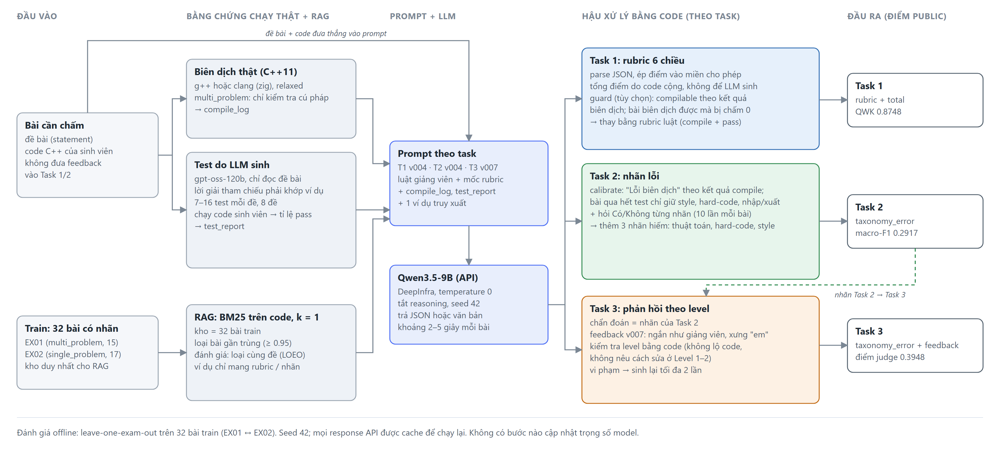

# Hướng Prompting – hướng dẫn chạy

Thư mục này chứa phần **Prompting** của nhóm cho cả 3 task, gồm:

| File | Nội dung |
|---|---|
| [`model/prompting_model.yaml`](model/prompting_model.yaml) | **"Model" sau khi tối ưu.** Hướng prompting không huấn luyện trọng số, nên phần được tối ưu và chốt lại là: LLM dùng, tham số sinh, prompt, cấu hình RAG, bộ sinh test, và hậu xử lý cho từng task. |
| [`run_prompting.py`](run_prompting.py) | Chạy lại toàn bộ pipeline bằng một lệnh, theo đúng file model ở trên. |

Điểm public của bản nộp:

| Task | Metric | Điểm |
|---|---|---|
| Task 1 | QWK | 0.8748 |
| Task 2 | macro-F1 | 0.2917 |
| Task 3 | LLM judge | 0.3948 |

## Pipeline



1. **Biên dịch** từng bài ở chế độ C++11 (dùng g++ nếu máy có, nếu không thì clang qua gói `ziglang`), ra compile log.
2. **Sinh test bằng LLM:** `openai/gpt-oss-120b` (qua Groq) chỉ đọc đề bài, viết lời giải mẫu và input test. Output mong đợi lấy từ việc chạy lời giải mẫu. Sau đó chạy code sinh viên trên bộ test này, ra test report. Không có test viết tay.
3. **RAG:** BM25 truy xuất 1 bài giống nhất theo code, từ 32 bài train có nhãn.
4. **Prompt (P2)** cho `Qwen/Qwen3.5-9B` qua DeepInfra, temperature 0. Prompt gồm hướng dẫn, 1 ví dụ, đề bài, code, compile log và test report.
5. **Hậu xử lý:**
   - Task 2: ghép prompt liệt kê nhãn với cách hỏi Yes/No từng nhãn (chỉ lấy thêm 3 nhãn hiếm).
   - Task 3: viết feedback dựa trên nhãn lỗi lấy từ Task 2.

Feedback của giảng viên không được đưa vào input của Task 1/2.

## 1. Cài đặt

Chạy ở thư mục gốc của repo, Python 3.10 hoặc 3.11:

```sh
uv sync            # hoặc: pip install -r requirements.txt && pip install -e .
pip install ziglang   # chỉ cần khi máy không có g++
```

Dữ liệu đặt cạnh repo, theo đường dẫn mặc định:

```text
LLM-FINAL/
  LLM-APA/        # repo này
  Data/public-test-cham-diem-phan-hoi-files/
    sample_dataset/sample_dataset/                 # 32 bài train có nhãn (RAG + đo điểm)
    public_test_release/public_test_release/       # tập public test
```

Nếu dữ liệu train để chỗ khác, thêm `--train <thư mục>` vào lệnh chạy.

## 2. API key

Cần 2 key, đặt trong biến môi trường (không ghi key vào file):

| Biến | Dùng cho | Khi nào cần |
|---|---|---|
| `DEEPINFRA_API_KEY` | Qwen3.5-9B chấm bài | Luôn cần |
| `GROQ_API_KEY` | gpt-oss-120b sinh test | Chỉ khi `outputs/testsuites/` chưa có bộ test của đề |

PowerShell:

```powershell
$env:DEEPINFRA_API_KEY = "<key>"
$env:GROQ_API_KEY = "<key>"
```

Bash:

```sh
export DEEPINFRA_API_KEY=<key>
export GROQ_API_KEY=<key>
```

## 3. Chạy trên tập test (tạo 3 file nộp)

```sh
python prompting/run_prompting.py --data ../Data/public-test-cham-diem-phan-hoi-files/public_test_release/public_test_release
```

Với private test, đổi `--data` sang thư mục private test (thư mục đó phải có `exams.json` và `submissions/`), và nên đặt tên riêng bằng `--name private`.

Kết quả nằm trong `outputs/runs/prompting/final/`:

```text
submission_task1.json
submission_task2.json
submission_task3.json
```

Script tự kiểm tra định dạng nộp của cả 3 file ở bước cuối.

- **Thời gian:** khoảng 40–60 phút cho 328 bài. Phần lâu nhất là Task 2 hỏi từng nhãn (3.280 câu hỏi) và Task 3.
- **Chi phí API:** khoảng $1.5. Mỗi bước có giới hạn chi phí riêng (`max_cost_usd` trong file model). Chạm giới hạn thì bước đó dừng lại.
- **Chạy lại:** câu trả lời API được lưu cache (`outputs/*.jsonl`). Lỗi giữa chừng thì chạy lại đúng lệnh cũ; phần đã xong lấy từ cache, không tốn thêm tiền. Nếu còn đủ cache của lần nộp, chạy lại sẽ ra **đúng các file đã nộp**.
- **Xem trước các lệnh sẽ chạy:** thêm `--dry-run`.

## 4. Đo điểm trên train (ablation, leave-one-exam-out)

```sh
python prompting/run_prompting.py --data ../Data/public-test-cham-diem-phan-hoi-files/sample_dataset/sample_dataset --eval --name train
```

Với `--eval`, bài đang chấm không bao giờ lấy ví dụ RAG từ cùng đề. Script in QWK (Task 1), macro-F1 (Task 2) và điểm nhãn/độ dài feedback (Task 3) so với nhãn giảng viên; không tạo file nộp.

So sánh các biến thể P0/P1/P2 bằng `scripts/run_all.py` (`<THAM SỐ API>` là các tham số `--base-url ... --reasoning-effort none` in ra bởi `--dry-run` ở trên):

```sh
python scripts/run_all.py --data <train> --eval <THAM SỐ API> --method zero_shot --no-evidence --name P0   # zero-shot, không bằng chứng
python scripts/run_all.py --data <train> --eval <THAM SỐ API> --no-evidence --name P1                      # RAG, không bằng chứng
python scripts/run_all.py --data <train> --eval <THAM SỐ API> --name P2                                    # RAG + biên dịch/test
```

## 5. Đổi cấu hình

Mọi lựa chọn đều nằm trong [`model/prompting_model.yaml`](model/prompting_model.yaml): model, API, prompt, k của RAG, nhãn hiếm dùng khi ghép, số shard của Task 3, giới hạn chi phí.

Muốn thử cấu hình khác thì chép file này ra file mới, sửa, rồi chạy với `--model-file <file mới>`. Giữ nguyên file gốc để còn tái tạo được bản nộp.

Prompt nằm trong `tasks/<task>/prompts/`. Mỗi lần sửa prompt thì lưu thành phiên bản mới, không sửa đè.

## 6. Các file trung gian

| Thư mục trong `outputs/runs/` | Nội dung |
|---|---|
| `prompting-P2/` | Task 1 + Task 2 dạng liệt kê nhãn: `pred_task1.json`, `pred_task2_calib.json`, log từng câu trả lời trong `task1/`, `task2/` |
| `prompting-t2pl/` | Task 2 hỏi từng nhãn: `pred_task2.probs.json` (P(Yes) của mọi nhãn), `pred_task2_combined.json` |
| `prompting-t3/` | Task 3: `pred_task3.json`, log trong `task3/` |
| `prompting/final/` | 3 file nộp |

`outputs/` không được commit, vì chứa code sinh viên và kết quả dự đoán.
